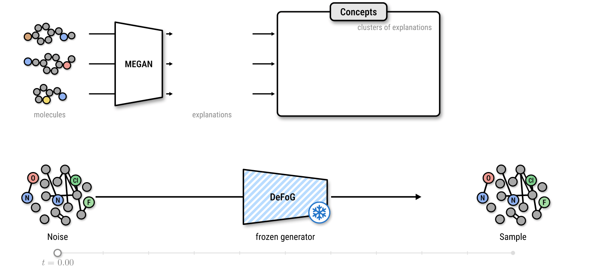
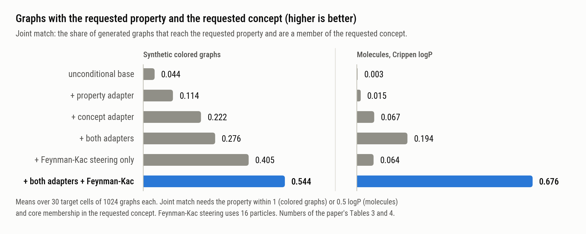

<h1 align="center">
  
</h1>

<p align="center">
  <a href="https://github.com/aimat-lab/defog-megan/actions/workflows/ci.yml"></a>
  
  <a href="LICENSE"></a>
  <a href="https://github.com/aimat-lab/defog-megan/releases/tag/v1.0.0"></a>
</p>

Ask a graph generator for a property, **and for the reason**. A frozen [DeFoG](https://arxiv.org/abs/2410.04263) discrete
flow-matching generator is steered by two small adapters, one for a **property** (a number or a class) and one for a
**concept**, the structural reason a graph has that property, read from a self-explaining GNN
([MEGAN](https://github.com/aimat-lab/graph_attention_student)). The adapters compose at sampling time, and Feynman-Kac
particle steering can use the explainer itself as the energy.

The banner shows the idea in two parts. Above, MEGAN explains molecules, and the glow marks the part that drives the
property. Explanations that look alike gather into a **concept** (A, B, C). Below, the frozen generator turns the same
noise into a molecule twice, both times asked for logP 2.5. It reaches 2.7 and 2.5, and MEGAN reads each molecule back. With
the property adapter alone, the explanation lands in whichever concept the molecule happens to realize (B, pink). With the
concept adapter as well, which takes concept A (orange) as its request, it lands in A. The lower run is a real recording, the
molecules above are drawn for the banner ([how it was made](docs/assets/banner/README.md)).

This is the code and the model zoo of the paper *Generating Graphs for a Reason: Explanation-Conditioned Adapters for
Discrete Flow Matching*. The generator side lives in [`defog-adapt`](https://github.com/aimat-lab/defog-adapt); this
repository adds the concept layer, the joint property and concept pipeline, the scorers, the experiments of the paper and a
**model zoo** with the trained models. It is research code, kept as close as possible to what produced the paper's numbers,
and **not** a general-purpose library ([scope of this release](#-scope-of-this-release)).

## 📦 Installation

Python 3.10 to 3.12. The explainer stack pins `torch<2.5.1` and `numpy<2`; the paper's runs used torch 2.5.0.

```bash
git clone https://github.com/aimat-lab/defog-megan && cd defog-megan
python -m venv .venv && source .venv/bin/activate
pip install torch==2.5.0 --index-url https://download.pytorch.org/whl/cpu      # or the CUDA build of 2.5.0
pip install -e ".[chem,megan,experiments]"
```

`chem` adds RDKit (the molecular experiments), `megan` the explainer stack (steering, grading and membership tables), and
`experiments` PyComex, which runs the experiments.

<details>
<summary>Python 3.12, and why RDKit is pinned</summary>

Python 3.12 additionally needs `pyarrow<26`, which the `megan` extra requests.

**RDKit is pinned to the release of the paper's runs (2026.03.4).** The property of the logP rung is RDKit's Crippen logP of the
decoded molecule, and that value differs between releases for a small share of molecules (11 of 6,833 sampled molecules
between 2026.03.4 and 2026.09.2, by up to 1.4), which moves the rung's error in the fourth decimal. With the pinned release the
scorers reproduce the paper's numbers exactly; the code warns once if another release is installed.

</details>

## 📊 Results at a glance

<p align="center">
  <picture>
    <source media="(prefers-color-scheme: dark)" srcset="docs/assets/results_dark.png">
    
  </picture>
</p>

A request for a property alone, or for a concept alone, is met on the other request only by chance. Both adapters together
reach both requests in 28% of the colored graphs and 19% of the molecules, and Feynman-Kac steering on top raises that to
54% and 68%, against 4% and 0.3% for the unconditional base. A distinct hit then costs a median of 2.2 samples on the colored
graphs (25.6 for the base) and 4.2 on the molecules (1024 for the base).

What the chart does not show. Every bar is the mean over 30 target cells, and single steered cells differed by up to 0.4
between two independent runs of the experiment, while the means moved by at most 0.03. The concept of a graph is read by the
explainer, the same model that defines the concept, so a joint match shows that the generator satisfies the explainer and
not that a substructure is chemically meaningful. Steered arms repeat graphs, so their rates over distinct graphs are lower
(uniqueness 0.82 on the colored graphs and 0.37 on the molecules). Experiment 4 of the paper, on mutagenicity, is graded by a
model and is not in the chart. The data behind the chart is [`docs/assets/results.json`](docs/assets/results.json).

## 🚀 Quickstart

Fetch the colored-graph models (about 300 MB, checked against the manifest) and ask for graphs with a property **and** a
concept:

```bash
python -m defog_megan.zoo fetch colorgraphs
python examples/quickstart.py          # concept ch0_cl3 and property -3, 64 graphs per arm
```

```text
request: concept ch0_cl3, property -3 (within 1); 64 graphs per arm, 500 steps on cuda
arm                       valid  property  concept  joint  seconds
frozen base                1.00      0.27     0.17   0.08      193
base + both adapters       0.98      0.98     0.97   0.94      591
joint = a connected graph with the requested property that is a member of the requested concept
```

The frozen base meets both requests in 8% of its graphs and the adapters in 94%. The seconds are from a shared 6 GB RTX 2060,
which is slow. The paper's runs recorded about 1.6 s per graph for both adapters and 0.5 s for the base on their GPUs, so
expect a couple of minutes on a recent card. On a CPU the defaults take hours (`--n 8 --steps 50` shows the effect there).

The script ([`examples/quickstart.py`](examples/quickstart.py)) loads the frozen base and the two adapters from the zoo and
samples with the paper's settings (500 steps, both adapters at weight 1). It reads both requests back exactly, the property
from the motif counts of each graph and the concept from the explainer. Other requests are one argument away
(`--concept ch1_cl12 --level 3`).

## 🧠 The model zoo

The trained models and the small data files that carry their contracts are in the **model zoo**, three groups of files
(`colorgraphs`, `zinc-logp`, `ames`; about 560 MB of core files in all), described by a manifest with the size and sha256 of
every file.

```bash
export DEFOG_MEGAN_ZOO=$HOME/defog-megan-zoo                  # the default is ~/.cache/defog-megan/zoo
python -m defog_megan.zoo fetch colorgraphs                   # downloads the group's archive from the release page,
python -m defog_megan.zoo fetch zinc-logp                     # checks it against the manifest, unpacks it
python -m defog_megan.zoo fetch ames
python -m defog_megan.zoo verify colorgraphs --ship core optional
```

Each group contains a `MODEL_CARD.md` that says what the models are, what they were trained on and what to know before using
them (the molecular base went through reinforcement learning; the colored-graph base is the epoch-80 snapshot of a 150-epoch
run; **every number of the Ames rung is model-graded**, and the Ames models derive from non-commercial data).

**The weights are pickles, and the explainer's processing module is Python code**: loading them runs code. The hashes in
the manifest show that a file is the one of the release; they do not show that it is safe. See [`docs/zoo.md`](docs/zoo.md).

## 🧪 Experiments

The paper has four experiments, and each has a script in [`reproduce/`](reproduce). It runs the paper's settings (500 steps,
multinomial resampling, the seeds of the paper's runs, 1024 graphs per cell) on the models of the zoo and splits the work over
the visible GPUs. The scorers in [`scripts/`](scripts) turn the samples into the paper's tables.

| Experiment | Paper | Run | Score |
|---|---|---|---|
| **1** Colored graphs, each adapter alone | Tables 1, 2 | [`exp1_colored_property.sh`](reproduce/exp1_colored_property.sh) | [`score_color_arms.py`](scripts/score_color_arms.py)<br>[`score_color_concepts.py`](scripts/score_color_concepts.py) |
| **2** Colored graphs, property and concept together | Table 3 | [`exp2_colored_joint.sh`](reproduce/exp2_colored_joint.sh) | [`score_color_joint.py`](scripts/score_color_joint.py) |
| **3** Molecules, Crippen logP | Table 4, Figure 2 | [`exp3_zinc_logp.sh`](reproduce/exp3_zinc_logp.sh) | [`score_mol_joint.py`](scripts/score_mol_joint.py) |
| **4** Molecules, Ames mutagenicity class | Figure 3 and its tables | [`exp4_ames.sh`](reproduce/exp4_ames.sh) | [`score_ames_joint.py`](scripts/score_ames_joint.py) |

The scorers compute these numbers.

- **Experiment 1.** Table 1 compares the property adapter with the base, the FiLM-only control and Feynman-Kac steering (MAE of
  the requested property, validity, uniqueness, novelty, KL to the data). Table 2 scores the concept adapter on the 19
  concepts (match rate, lift over the base, shift of the property).
- **Experiment 2.** Six arms over 30 cells (validity, property match, concept match, joint match, distinct hits).
- **Experiment 3.** The same for molecules, with the exact Crippen logP.
- **Experiment 4.** The same for the Ames class, model-graded.

To run one, point `DEFOG_MEGAN_ZOO` at the zoo and call its script.

```bash
export DEFOG_MEGAN_ZOO=$HOME/defog-megan-zoo

# Experiment 2 at the paper's settings, long on one GPU (NUM_SHARDS splits it over several)
reproduce/exp2_colored_joint.sh

# the same chain as a tiny run, minutes on a CPU
EXTRA="--__TESTING__ True" NUM_SHARDS=1 reproduce/exp2_colored_joint.sh
```

The colored-graph scripts need only the zoo. The molecular scorers also need tables of the molecules, which hold SMILES and
are therefore not in the zoo: `reproduce/prepare_tables.sh ames` and `reproduce/prepare_tables.sh zinc` build them from the
public data, and they are the paper's tables.

<details>
<summary>The molecular tables, what a run costs, and what a rerun gives</summary>

The molecular scorers need the memberships, the logP or class probability of the pool, and the training molecules for the
novelty column. The molecules, their labels and the exact logP come out identical to the paper's files, byte for byte (the
corpus steps `scripts/prepare_ames_defog.py` and `scripts/prepare_zinc_defog.py` decode the public molecules through the
base's vocabulary and keep each decoded molecule once). The memberships are recomputed by the explainer and came out bitwise
equal to the paper's in the checks (CPU runs); another machine's float arithmetic can differ in the last digits.

**What it costs.** One Feynman-Kac unit at the paper's settings (500 steps, 16 particles, the explainer on the CPU) took about 10
minutes for 128 colored graphs (Experiment 2), 14 minutes for 256 molecules (Experiment 3) and 12 minutes for 256 Ames molecules
(Experiment 4) on an RTX 3060 with 8 CPU threads, using under 2 GB of the GPU's memory. The joint rungs of the paper (1024 graphs
per cell) took on the order of 100 GPU-hours in all; `NUM_SHARDS` splits them over devices.

**What a rerun gives.** Sampling is stochastic and a GPU run is not bit-reproducible across hardware, so a rerun agrees with the
paper within sampling error, not exactly. The scorers, on the other hand, are exact functions of the samples: given the paper's
own samples they give the paper's numbers (checked: Tables 1 and 2 come out identical to the reports of the research code,
for example a mean concept match of 0.723 against an unconditional 0.064, a property shift of 1.215, which is 20.3% of the
range; the arms of Table 1 give a property MAE of 0.148 for the adapter at weight 2 against 0.026 with Feynman-Kac steering).

</details>

## 🧩 What is in it

| path | what |
|---|---|
| `experiments/` | the experiments, one [PyComex](https://pypi.org/project/pycomex/) module each: training the colored base and the adapters, the evaluations, the concept tables, and the joint samplers of the three settings (`sample_color_joint`, `sample_mol_joint`, `sample_ames_joint`). Parameters are module-level constants with the paper's settings as defaults; `--__TESTING__ True` runs a tiny version. |
| `examples/` | the quickstart |
| `scripts/` | the scorers, the data preparation of the Ames and ZINC sets, `collect_shards.py`, the zoo tools |
| `reproduce/` | the scripts that run the paper's settings end to end |
| `src/defog_megan/` | `concepts` (the membership contract and the explainer runtime), `bundle` (an explainer bundle and its reference check), `colorgraphs` and `rb_motifs` (the synthetic domain and its exact property), `molecules` (the molecule codec, with a strict charge-aware reading for the Ames base), the Feynman-Kac energies, `evaluate`, `sizes`, and `zoo` |
| `tests/` | the unit tests, run with `pytest` (CPU, a minute; the ones that need the zoo skip without it) |
| `docs/` | the model zoo, the architecture, and the assets of this page |

## 📚 Documentation

* [`docs/architecture.md`](docs/architecture.md): how the pieces fit together.
* [`docs/zoo.md`](docs/zoo.md): the model zoo, its manifest, the ship levels and the licence notes.
* [`CHANGELOG.md`](CHANGELOG.md): what is in each release.
* [`docs/assets/banner/README.md`](docs/assets/banner/README.md): how the banner was recorded and drawn.

## 🧭 Scope of this release

**v1.0 is the code of the paper.** The four experiments of the main text (colored graphs: property alone, then property and
concept together; molecules steered towards Crippen logP; the Ames mutagenicity class) run from this repository, and the
numbers of the paper can be re-derived from its raw samples. The experiments of the appendices (end-to-end baselines,
prototype size sweep, inpainting, per-cell tables) are not included yet and come in a later release. The code is research
code, kept as close as possible to what produced the paper's numbers, and its interfaces may change.

The training code of some models lives elsewhere: the two molecular bases and the logP property adapter were trained with the
DeFoG implementation and the MEGAN models with the MEGAN repositories. This repository trains the colored-graph base and the
adapters of the paper and uses the trained files of the others from the zoo.

## 📝 Citation, relationship to DeFoG and licence

The generator follows the upstream [DeFoG](https://github.com/qym7/DeFoG) implementation (Qin, Madeira, Thanou, Frossard;
ICML 2025) through `defog-adapt`. This package is not affiliated with or endorsed by the DeFoG authors. See
[`NOTICE`](NOTICE) for the credits and [`CITATION.cff`](CITATION.cff) for how to cite; the reference of the paper is added
there when it is public. The code is MIT, see [`LICENSE`](LICENSE). **The data behind the models carries its own terms**,
stated in the model cards: the colored graphs are generated by code and free, ZINC is free to use with redistribution of large
subsets subject to permission, and the Ames data is non-commercial, so models derived from it are treated that way.
